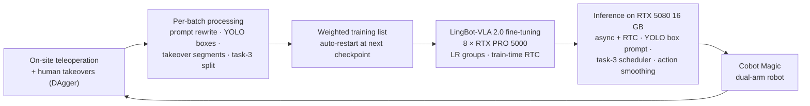

# From Simulation to a 48-Hour Real-Robot Final: Our LingBot Embodied-AI Challenge Entry

**English** | [简体中文](README.zh-CN.md)

[](LICENSE)
[](https://github.com/Robbyant/lingbot-vla-v2)

This repository documents our team's full run through the first **Ant LingBot Embodied Foundation Model Challenge** (蚂蚁灵波具身大模型挑战赛): a simulation preliminary round on RoboTwin 2.0 and a 48-hour real-robot final on an AgileX Cobot Magic dual-arm robot. Everyone had to build on the same base model, [LingBot-VLA 2.0](https://github.com/Robbyant/lingbot-vla-v2) (a 6B vision-language-action model). The contest was about how far you can take one strong foundation model with data, training recipes and inference-side engineering.

Everything here is what we actually ran: code snapshots, the training history and the analysis behind each decision, including the one that went wrong.

> **Team fbfyfbf队** · Final: **9th of 15 teams**, best score **53.05** (round 2) · Preliminary: official re-test **69.74** average (82.22 clean / 57.26 randomized), 6th in the published re-test table of 15 teams.

## Highlights

- **Preliminary round (simulation, 50 bimanual tasks).** Fine-tuning LingBot-VLA 2.0 on clean demonstrations only, with augmentation designed to stay within the official augmentation rules. Training ran on preemptible GPU partitions with automatic hand-off between GPU types and time-based checkpointing. Our submitted model (scratch 22k + 8k continuation) got an official re-test of **82.22 clean / 57.26 randomized**, very close to our own 50–60-episode evaluation (82.9 % / 58.9 %). [→ details](docs/prelim/README.md)
- **One model, three real-robot tasks, trained while the event was running.** New on-site data arrived every one to two hours. Each batch was cleaned, re-weighted and merged into the training list automatically, and training restarted at the next checkpoint without losing steps. [→ training](docs/final/training.md) · [→ data](docs/final/data.md)
- **Visual box prompts for "which object, which target".** A YOLO detector, retrained 13 times with human-checked labels, draws a white box on the target object and an orange box on the destination. Training data and inference draw the boxes with identical rules, verified pixel by pixel. [→ YOLO](docs/final/yolo.md)
- **Asynchronous inference with real-time chunking (RTC).** We trained the model to continue from a given action prefix, then enabled asynchronous execution on the 16 GB inference GPU, so the robot no longer pauses between action chunks. [→ inference](docs/final/inference.md)
- **A sub-task scheduler for the long bimanual task.** The sweeping task is cut into grasp / sweep / dump / home. An LLM judges progress from three camera views, and a 205k-parameter CNN checks whether each hand really holds its tool (99.8 % held-out accuracy). [→ task-3 harness](docs/final/task3_harness.md)
- **An honest post-mortem.** Our last submission was trained longer, on more data, and scored *lower* than the previous one (51.25 vs 53.05). We trace this to the recency-weighting rule and to slower recent demonstrations, and list what we would do differently. [→ post-mortem](docs/final/postmortem.md)

## System overview (final)



## Results

| Stage | What we submitted | Official result |
|---|---|---|
| Preliminary | Scratch 22k + 8k continuation, one checkpoint for both settings | Re-test 82.22 clean / 57.26 randomized, average **69.74** (6th of 15 in the published re-test table) |
| Final, round 1 | Training stage v3, step 2000 | 24.35 |
| Final, round 2 | Overall step 11,500 | **53.05** (our best; **9th of 15 teams**) |
| Final, round 3 | Overall step 15,200 | 51.25 |

From round 1 to round 2 the score more than doubled: the round-1 weights had only 2,000 training steps, while the round-2 weights had 9,500 more steps on most of the data collected on site.

From our own inference logs for the sweeping task: in round 2, 10/10 episodes reached the sweep stage and 5/10 reached dumping. In round 3, the brush hand failed to grasp in 3/10 episodes, which is the regression analysed in the post-mortem. See [docs/final/results.md](docs/final/results.md).

## Repository layout

```text
.
├── docs/                    Write-ups (Chinese); start at docs/README.md
│   ├── competition.md       The challenge in brief (public information only)
│   ├── timeline.md          Timeline from the prelim to the end of the final
│   ├── prelim/              Preliminary round: recipe, augmentation, evaluation, results
│   ├── pre_final/           Plan, decision log and simulation experiments before the final
│   └── final/               Final: data, training, inference, YOLO, task-3 harness, tooling, results, post-mortem
├── prelim/                  Preliminary-round code (Slurm training/eval, augmentation, DINOv2 fusion, AMD eval port)
├── experiments/             Pre-final simulation experiments (detector, task routing, sweep harness, HPC replica)
├── final/
│   ├── training/            Training-framework patches p00–p10, list generator, auto-restart, checkpoint publishing, submission packaging
│   ├── inference/           Modules that ran on the inference machine in round 3 (RTC, yolocue, robotharness + grasp CNN, actsmooth, takeover handling)
│   ├── data/                Per-batch data processing, auto-labelling, YOLO relabelling pipeline
│   └── tools/               Web dashboards, live harness viewer, helpers for a bastion-only dev machine
├── THIRD_PARTY.md           Upstream projects and licenses
└── LICENSE                  Apache-2.0
```

## Reading guide

| If you want to… | Read |
|---|---|
| Get the whole story in 10 minutes | [docs/competition.md](docs/competition.md) → [docs/timeline.md](docs/timeline.md) → [docs/final/README.md](docs/final/README.md) |
| See how we trained a VLA while data kept arriving | [docs/final/training.md](docs/final/training.md), [docs/final/data.md](docs/final/data.md) |
| Reuse an inference-side trick | [docs/final/inference.md](docs/final/inference.md) and the module READMEs under [final/inference/](final/inference/) |
| Learn from our mistakes | [docs/final/postmortem.md](docs/final/postmortem.md), [docs/final/task3_harness.md](docs/final/task3_harness.md) |
| Run large training jobs on preemptible GPUs | [docs/prelim/](docs/prelim/README.md) |

## Can I run this?

Partly.

- **Preliminary round:** the training and evaluation scripts target LingBot-VLA 2.0 + RoboTwin 2.0 on a Slurm cluster and can be adapted (see [prelim/README.md](prelim/README.md)).
- **Final:** the code ran inside the organizers' training platform and inference service, which are not public. We publish it as a reference implementation. Several pieces are self-contained and have offline tests:
  - the train-time RTC patch: `final/training/patches/test_p10.py`;
  - the box-prompt module: `final/inference/yolocue/test_yolocue.py`;
  - the task-3 subtask split: `experiments/sweep_harness/code/real_split.py`;
  - the grasp CNN: `final/inference/graspnet_train/`.
- No datasets, checkpoints or robot recordings are included.

## Acknowledgements

We thank the organizers of the challenge, the [LingBot-VLA 2.0](https://github.com/Robbyant/lingbot-vla-v2) team for open-sourcing the base model, and the authors of [RoboTwin 2.0](https://github.com/RoboTwin-Platform/RoboTwin), [Ultralytics YOLO](https://github.com/ultralytics/ultralytics), [DINOv2](https://github.com/facebookresearch/dinov2) and LocateAnything. See [THIRD_PARTY.md](THIRD_PARTY.md).

## Team

**fbfyfbf队**: Yixia Yu (余宜夏), Weihang Fang (方伟航), Junhao Liu (刘俊豪), Pengyu Zhao (赵鹏宇), Peishan Zhong (钟沛珊).

## License

Our code and documentation are released under the [Apache License 2.0](LICENSE). Upstream projects keep their own licenses ([THIRD_PARTY.md](THIRD_PARTY.md)).
