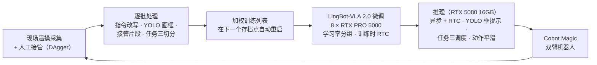

# 从仿真到 48 小时真机决赛：我们的蚂蚁灵波具身大模型挑战赛参赛记录

[English](README.md) | **简体中文**

[](LICENSE)
[](https://github.com/Robbyant/lingbot-vla-v2)

这个仓库记录了我们队参加首届**蚂蚁灵波具身大模型挑战赛**的全过程：初赛在 RoboTwin 2.0 仿真里做 50 个双臂任务，决赛是在松灵 Cobot Magic 双臂机器人上进行的 48 小时真机赛。所有队伍用同一个基座模型 [LingBot-VLA 2.0](https://github.com/Robbyant/lingbot-vla-v2)（6B 参数的视觉-语言-动作模型），比的是怎么靠数据、训练配方和推理端工程把它用好。

这里放的都是我们实际跑过的东西：代码快照、训练过程，以及每个决定背后的分析，包括做错了的那一个。

> **fbfyfbf队** · 决赛：**15 支队伍中第 9 名**，最佳成绩 **53.05**（第二轮） · 初赛：官方复测平均 **69.74**（clean 82.22 / randomized 57.26），在公布的 15 支队伍复测表中排第 6。

## 亮点

- **初赛（仿真，50 个双臂任务）**：只用 clean 示范微调 LingBot-VLA 2.0，数据增强按官方的增强规则设计。训练跑在可抢占的 GPU 分区上，多种 GPU 型号之间自动接力，按时间存档。提交的模型（从头训 22k + 续训 8k）官方复测 clean 82.22、randomized 57.26，和我们自己每任务 50–60 回合的评测（82.9% / 58.9%）非常接近。[→ 详情](docs/prelim/README.md)
- **一个模型做三个真机任务，边比赛边训练**：现场每隔一两个小时就有一批新数据。每批自动清洗、重新加权、并入训练列表，在下一个存档点重启训练，不丢步数。[→ 训练](docs/final/training.md) · [→ 数据](docs/final/data.md)
- **用画框告诉模型"拿哪个、放哪里"**：用人工核对标注、迭代了 13 版的 YOLO，在目标物上画白框、目的地上画橙框。训练数据和推理时按完全相同的规则画框，逐像素核对过。[→ YOLO](docs/final/yolo.md)
- **异步推理 + RTC**：训练时让模型学会接着给定的动作前缀往下生成，推理时在 16 GB 的推理卡上打开异步执行，机器人在动作块之间不再停顿。[→ 推理端](docs/final/inference.md)
- **长程双臂任务的子任务调度**：把清扫任务切成 抓取 / 扫 / 倒 / 归位，由大模型看三路画面判断进度。再用一个 20.5 万参数的小 CNN 判断每只手是否真的握住了工具，留出集准确率 99.8%。[→ 任务三 harness](docs/final/task3_harness.md)
- **如实的复盘**：最后一次提交训练更久、数据更多，成绩却比上一次低（51.25 对 53.05）。我们把原因追到了按新旧加权的规则和后期示范动作变慢，并写下了下次会怎么做。[→ 复盘](docs/final/postmortem.md)

## 系统总览（决赛）



## 结果

| 阶段 | 提交内容 | 官方成绩 |
|---|---|---|
| 初赛 | 从头训 22k + 续训 8k，clean 和 randomized 共用一个 checkpoint | 复测 clean 82.22 / randomized 57.26，平均 **69.74**（公布的复测表 15 支队伍中第 6） |
| 决赛第一轮 | 训练阶段 v3 第 2000 步 | 24.35 |
| 决赛第二轮 | 总 11500 步 | **53.05**（最佳成绩；**15 支队伍中第 9 名**） |
| 决赛第三轮 | 总 15200 步 | 51.25 |

第一轮到第二轮成绩翻了一倍多：第一轮的权重只训了 2000 步，第二轮的权重又多训了 9500 步，用上了现场采的大部分数据。

以下统计来自我们自己的推理日志，看的是清扫任务。第二轮 10 局全部进入"扫"，5 局进入"倒"；第三轮有 3 局刷子一直没握住，这就是复盘里分析的退化。见 [docs/final/results.md](docs/final/results.md)。

## 目录结构

```text
.
├── docs/                    文档（中文），从 docs/README.md 开始
│   ├── competition.md       比赛简介（只含公开信息）
│   ├── timeline.md          从初赛到决赛结束的时间线
│   ├── prelim/              初赛：训练配方、数据增强、评测、结果
│   ├── pre_final/           决赛前：技术方案、决策记录、仿真实验
│   └── final/               决赛：数据、训练、推理端、YOLO、任务三 harness、工具、结果、复盘
├── prelim/                  初赛代码（Slurm 训练评测、数据增强、DINOv2 融合、AMD 评测移植）
├── experiments/             决赛前的仿真实验（检测器、任务路由、清扫 harness、集群复现）
├── final/
│   ├── training/            训练框架补丁 p00–p10、列表生成、自动重启、存档发布、提交打包
│   ├── inference/           第三轮推理机上实际运行的模块（RTC、yolocue、robotharness + 抓取网络、actsmooth、接管处理）
│   ├── data/                逐批数据处理、自动标注、YOLO 人工核对流程
│   └── tools/               网页看板、harness 实时视图、堡垒机后开发机的操作工具
├── THIRD_PARTY.md           上游项目和许可证
└── LICENSE                  Apache-2.0
```

## 阅读指南

| 想看 | 读这些 |
|---|---|
| 10 分钟了解全貌 | [比赛简介](docs/competition.md) → [时间线](docs/timeline.md) → [决赛总览](docs/final/README.md) |
| 数据不断进来时怎么训 VLA | [训练](docs/final/training.md)、[数据](docs/final/data.md) |
| 复用推理端的做法 | [推理端](docs/final/inference.md)，以及 [final/inference/](final/inference/) 下各模块的 README |
| 从我们的错误里学点东西 | [复盘](docs/final/postmortem.md)、[任务三 harness](docs/final/task3_harness.md) |
| 在可抢占 GPU 上跑大规模训练 | [初赛](docs/prelim/README.md) |

## 能跑起来吗

部分可以。

- **初赛**：训练和评测脚本面向 Slurm 集群上的 LingBot-VLA 2.0 + RoboTwin 2.0，改改路径就能用（见 [prelim/README.md](prelim/README.md)）。
- **决赛**：代码运行在主办方的训练平台和推理服务里，这两样不公开，所以这里作为参考实现发布。下面几块是独立的，带离线测试：
  - 训练时 RTC 补丁：`final/training/patches/test_p10.py`；
  - 画框模块：`final/inference/yolocue/test_yolocue.py`；
  - 任务三子任务切分：`experiments/sweep_harness/code/real_split.py`；
  - 抓取检测网络：`final/inference/graspnet_train/`。
- 仓库里不包含数据集、模型权重和机器人录像。

## 致谢

感谢比赛主办方，感谢 [LingBot-VLA 2.0](https://github.com/Robbyant/lingbot-vla-v2) 团队开源基座模型，以及 [RoboTwin 2.0](https://github.com/RoboTwin-Platform/RoboTwin)、[Ultralytics YOLO](https://github.com/ultralytics/ultralytics)、[DINOv2](https://github.com/facebookresearch/dinov2)、LocateAnything 的作者。见 [THIRD_PARTY.md](THIRD_PARTY.md)。

## 队伍

**fbfyfbf队**：余宜夏、方伟航、刘俊豪、赵鹏宇、钟沛珊。

## 许可证

我们的代码和文档以 [Apache License 2.0](LICENSE) 发布，上游项目保留各自的许可证（[THIRD_PARTY.md](THIRD_PARTY.md)）。
