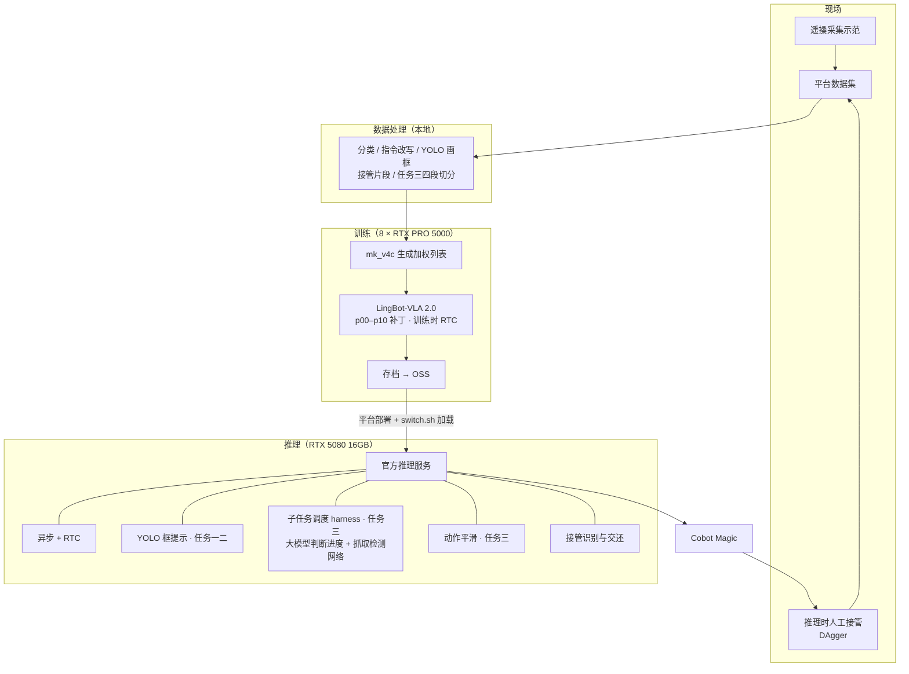

# 决赛：48 小时真机赛

三个任务（单臂抓放、化妆品收纳、双臂清扫），一个 LingBot-VLA 2.0 模型同时做三个任务。比赛期间一边在现场采数据，一边在开发机上训练，一边在推理机上测试，共提交三轮。

## 系统总览

## 文档

| 文档 | 内容 |
|---|---|
| [data.md](data.md) | 采了什么、每批怎么处理、任务三怎么切成四段、接管数据怎么切 |
| [training.md](training.md) | 三个训练阶段、训练配置和代码补丁、数据加权规则、不停训接入新数据、三轮提交 |
| [inference.md](inference.md) | 推理机上的各个模块：异步 + RTC、YOLO 框提示、动作平滑、接管识别与交还 |
| [yolo.md](yolo.md) | 从开放词汇自动标注到 v13 的检测器迭代 |
| [task3_harness.md](task3_harness.md) | 任务三的子任务调度：各版本、抓取检测网络、第三轮的教训 |
| [tooling.md](tooling.md) | 现场看板、训练看板、harness 实时视图、堡垒机后的开发机操作、提交打包 |
| [results.md](results.md) | 官方成绩（最佳 53.05，第 9 名）和日志统计 |
| [postmortem.md](postmortem.md) | 复盘：第三轮权重为什么不如第二轮 |

时间线见 [../timeline.md](../timeline.md)。

## 几个关键设计

1. **一个模型做三个任务，任务三按子任务训练。** 任务三的示范切成 抓取 / 扫 / 倒 / 归位 四段，每段一条固定指令；推理时由 harness 判断进度、切换指令。
2. **画框提示解决"拿哪个、放哪里"。** 训练数据一半画框、一半原图，推理时用同一套规则画框，检测不确定就给原图。
3. **异步推理 + RTC。** 训练时让模型学会接着已有的动作前缀往下生成，推理时就能边执行边推理，动作块之间不停顿。
4. **数据持续接入。** 新数据一到就生成新列表，在下一个存档点自动重启，训练不中断。
5. **所有推理端模块都可热切换、出错即退回。** 每个模块一个开关文件，下一局生效，出错时模型拿到原始输入。

## 代码

| 路径 | 内容 |
|---|---|
| [final/training/](../../final/training/) | 训练补丁、列表生成、自动接入、存档发布、提交打包 |
| [final/inference/](../../final/inference/) | 推理端模块（第三轮推理机上实际运行的版本） |
| [final/data/](../../final/data/) | 数据处理脚本、YOLO 标注流程 |
| [final/tools/](../../final/tools/) | 看板、harness 实时视图、开发机操作工具 |
