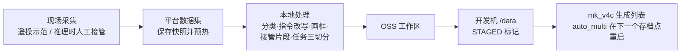

# 决赛：数据

决赛只允许用两类数据训练：主办方开幕时公布的 647 条示范，和我们在现场机器人上采集的数据。所以数据工作的重点是：现场采什么、怎么尽快把每一批变成可训练的数据集、以及怎么给不同来源的数据定权重。

本页按数据流的顺序讲。权重规则在 [training.md](training.md#4-数据列表怎么决定每份数据的权重) 里，YOLO 框标注见 [yolo.md](yolo.md)。

## 1. 数据流

- 采到的数据要先在平台上保存快照、预热，才会出现在开发机上，所以最快也是分钟级。
- 数据处理放在本地 Mac 或推理机上做，不在训练机上做，训练机只训练。处理好的数据集经 OSS 工作区传到开发机。
- 每批处理完写一个 `STAGED_<批次>.txt`，自动接入脚本看到它才把这一批放进下一次重启的列表。

## 2. 现场采了什么

每批用平台快照 ID 的前 4 位命名，括号里是它在新旧权重阶梯上的编号（官方数据和早期自采占了前面的编号，所以从 11 开始），来自平台上的三个数据集。下表是进入训练的主要批次，完整的逐段记录见[第三轮提交说明](../../final/training/submissions/README_third_15200.md)。

| 批次（编号） | 内容 | 进入训练 |
|---|---|---|
| 第一天夜里（new1115 等） | 三个任务的自采示范 | 总 4000 步起 |
| 0200（11） | 任务一易混水果 | 5000 |
| 0308（12） | 以任务二为主 | 5500 |
| 4a2a（13）、9f7c（14） | 任务一、二示范 | 6500、7000 |
| fb04（15）、42e9（16） | 示范 + 第一批人工接管数据 | 8000 |
| 3541（17）、f64d（18） | 示范 + 接管 | 8500 |
| b6ef（19） | 示范 + 任务二接管 | 10000 |
| 908a（20）、7723（21） | 任务二、三；任务三接管按子任务拆分 | 10500 |
| 2c3d（22） | 任务二接管 15 条、任务三示范 8 条 | 11500 |
| e94f（23）、c89c（24） | 任务二示范 18 条；任务一 4 条、任务三 11 条 | 12500 |
| e04f（25） | 任务一 10 条、任务二 21 条、任务三 4 条 | 13500 |
| 4055（26）、42da（27）、2ffa（28） | 任务二 23 条、任务一 15 条；任务三示范 1 条 + 接管 3 条 | 14000 |
| ad7e、dade、2218、4393、4f62、7928、0e70（29–35） | 任务三：示范 6 条、接管 19 条 | 14500 |

采集怎么分配，靠[现场看板](tooling.md#现场看板field)：用头部相机第 0 帧统计每个目标物、目的地、桌面区域被采了多少次，每次换班看哪些组合偏少，下一班就补那些。

## 3. 每批怎么处理

每批一组脚本，在 [final/data/batches/](../../final/data/batches/)，数据处理代码的总说明见 [README_data_prep_1115.md](../../final/data/README_data_prep_1115.md)。

1. **分类**（`classify_<批次>.py`）：区分普通遥操示范和推理时的人工接管录像。接管录像里策略执行的帧和人遥操的帧混在一起，用 [`dagger_seg.py`](../../final/data/batches/dagger_seg.py) 比较指令和实际状态，找出人接手的片段，只保留这些片段。
2. **任务一、二**（`own_<批次>.py`）：
   - 指令改写成官方的指令模板（模板表 `prompt_policy.json`），让训练和评测时的说法一致；
   - 用 YOLO 在第 0 帧上找目标物和目的地，生成带框版本（规则和推理端完全一样，见 [inference.md](inference.md#yolo-框提示yolocue)）；
   - 抓取检查：夹爪有没有合上、合了几次。
3. **任务三**（`t3_<批次>.py`）：把每条示范切成 抓取 / 扫 / 倒 / 归位 四段，每段配一条固定指令，与推理时的子任务调度一致。
   - 切分规则在 [real_split.py](../../experiments/sweep_harness/code/real_split.py)：用两只夹爪的开度和末端位置找边界。夹爪"张开"的阈值 0.38，取在握着工具时的最高读数（0.338）和抓取时张开的最低读数（0.44）之间；握簸箕和握刷子的开度不同（约 0.29–0.36 和 0.19–0.27），据此判断哪只手拿簸箕。
   - 接管录像：人接手时所在的那个子任务按接管数据加权，之后人完成的子任务按普通示范加权。
   - 每批的切分边界都对照画面人工核对过，结论记在 `t3_<批次>_final.json`。
4. **生成数据集**（`build_<批次>.py`），写 `STAGED` 标记。

## 4. 清洗

- 标错的示范从副本中删除，列表只用删除后的副本（`*_d`、`*_drop193`）：例如官方带框数据里有两条框在错的水果上，有一条把木瓜标成了芒果。
- 接管片段的假阳性：人工示范里只有抖动、没有夹爪输出的"接管"标记，按普通示范处理。
- 半路结束、人手入镜、没有动作的片段整段丢弃。
- 第一天还做过一次数据审计（[final/data/autolabel/audit_1114/](../../final/data/autolabel/audit_1114/)）：核对每份数据的来源、任务内角色、自采和官方数据有没有重复。

## 5. 赛后发现的问题

第三轮权重抓刷子明显变慢，回头量训练数据发现：后加的任务三示范，人抓工具本身就越来越慢（抓取段从早期批次的约 10 秒，到最后几批的 17–21 秒），而这些批次权重最高，几条示范就占了抓取段很大一块样本。另外部分接管片段里刷子夹爪大部分时间张着，没有合上的过程。详细数字见 [postmortem.md](postmortem.md)。

教训：每批数据进训练前，除了检查标注，还应该统计它会在每个子任务里占多少样本，以及动作本身（时长、抓取方式）和已有数据比有没有明显不同。

## 6. 文件

| 路径 | 内容 |
|---|---|
| [final/data/batches/](../../final/data/batches/) | 每批的分类、处理、任务三切分、建库脚本，以及框提示记录和人工核对结论（`*_cues.json`、`*_final.json`） |
| [final/data/autolabel/](../../final/data/autolabel/) | 第一天的自动标注和带框数据集生成（`derive_box_dataset.py`、`build_cue_prompts.py` 等） |
| [final/data/yolo/](../../final/data/yolo/) | YOLO 各版本的候选框、修正表、训练和评测脚本（见 [yolo.md](yolo.md)） |
| [final/training/labels/](../../final/training/labels/) | 908a 批次任务三接管数据的切分标注 |

原始数据和处理好的数据集都不在仓库里。
