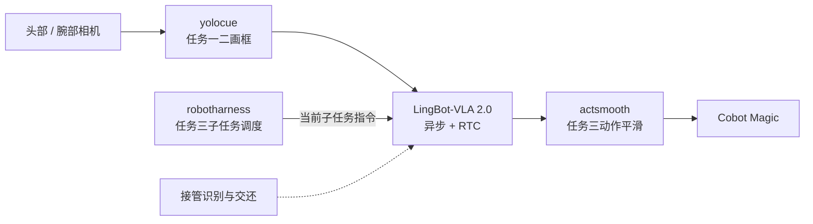

# 决赛：推理端

评测时模型跑在机器人旁边的一台推理机上：RTX 5080，16 GB 显存。LingBot-VLA 2.0 只能以 BF16 加载，加载后显存只剩 2 GB 左右，所以推理端不能再放大模型，额外的模块都要轻：YOLO 跑在 CPU 上，任务三的抓取检测网络只有 20 万参数。

推理服务本身是主办方提供的（systemd 常驻，带一个命令接口，负责取相机画面、调模型、下发动作）。我们没有改它的主体，而是写成一组补丁模块，在服务启动时挂到它的几个关键位置上。每个模块都有一个 `mode` 文件做开关（`off` / `shadow` / `on`），在每次开始推理时读取，切换不用重启；任何一个模块出错都退回原始行为，不会挡住推理。

| 模块 | 作用 | 代码 |
|---|---|---|
| 异步推理 + RTC | 推理和执行重叠，动作块之间平滑衔接，不停顿 | [final/inference/rtc/](../../final/inference/rtc/) |
| yolocue | 任务一、二：在头部画面上画出和训练数据一样的目标框、目的地框 | [final/inference/yolocue/](../../final/inference/yolocue/) |
| robotharness | 任务三：把长任务拆成 抓取 / 扫 / 倒 / 归位，按进度切换发给模型的指令 | [final/inference/robotharness/](../../final/inference/robotharness/)，详见 [task3_harness.md](task3_harness.md) |
| actsmooth | 任务三：平滑每个动作块里的高频抖动 | [final/inference/actsmooth/](../../final/inference/actsmooth/) |
| 接管记录与交还 | 记录人工接管的起止，交还时从当前姿态重新规划 | [final/inference/dagger/](../../final/inference/dagger/) |
| 对官方代码的改动 | 上面几项需要改到的官方文件，以 diff 形式给出 | [final/inference/upstream_patches/](../../final/inference/upstream_patches/) |

## 异步推理 + RTC

同步推理时，机器人执行完一个动作块才拍下一帧、推理下一块，每块之间停顿约 0.4 秒。官方服务本身支持异步（后台准备下一块），但 LingBot 的适配器和配置校验把 RTC（real-time chunking，下一块以上一块剩下的动作为前缀生成）挡住了。我们打开了它，并在训练端加了对应的训练方式（[training.md](training.md#2-训练配置) 的 p10）。

- 参数：推理约 0.35–0.47 秒，即 30 Hz 下 11–14 步。每块执行到还剩 20 步时请求下一块，把这 20 步作为前缀（训练时前缀最长 24 步）。下一块大约在第 14 步时接上，每块新执行约 24 步。
- 前缀要换算到模型的动作空间（归一化、相对当前关节、补齐维度）。官方的特征变换每一维都是仿射的，用一次探测就能求逆；换算后再还原一遍，复现不了前缀就不用前缀。
- 只有 RTC 训练过的权重才挂前缀（权重目录里有标记文件，或路径写在 `allow.txt`）。测试表明没训练过的权重会忽略前缀，接缝处跳 0.1–0.24 rad，所以不加 RTC 训练就开异步是有害的。
- 切换脚本 `switch.sh rtc <hf_ckpt> --trained`：标记权重、换配置、在服务空闲时重启并重新加载权重；有会话在跑时拒绝执行。

细节和测试结果见 [rtc/README.md](../../final/inference/rtc/README.md)。

## YOLO 框提示（yolocue）

训练数据里有一半任务一、二的示范在头部画面上画了框：白框标目标物，橙框标目的地（[data.md](data.md#3-每批怎么处理)）。推理时要按同样的规则画上，模型才能用上这部分训练。

- 开始推理时对第一帧跑 YOLO（TorchScript，CPU，单次约 18 ms，不占显存），按指令解析出目标类别和目的地，选框规则、检测参数、画法都和生成训练数据时逐项一致。离线核对过：759 张训练用第 0 帧的检测结果全部在容差内，画出的框和训练数据逐像素相同。
- 目标不确定（没检出、分数不够、和第二名差距太小）就不画，模型拿到原图，这种图训练时也占一半。
- 夹爪指令先张开再合上，就认为抓到了，去掉白框，橙框保留。
- 重抓保险：抓过之后夹爪又张开，就在画面里找目标物。它不在目的地上，说明没抓住或掉了，把白框画回去，重新等抓取；它在目的地上，就记为放好了。
- 任务三不画框。

细节见 [yolocue/README.md](../../final/inference/yolocue/README.md)，YOLO 模型本身的迭代见 [yolo.md](yolo.md)。

## 动作平滑（actsmooth）

录下的策略指令里，每个动作块内部都有高频噪声：手臂关节每秒反向约 11 次（人遥操时约 0.3 次），夹爪实测每秒抖 2–2.6 次。这个噪声不在 RTC 接缝处，而在块内部。actsmooth 在模型输出之后、下发之前处理每个动作块：

- 手臂关节：Savitzky-Golay 滤波（窗口 9 步 = 0.3 秒，二阶），居中、不引入延迟，保留 3 Hz 以下的运动。
- 夹爪：7 步中值滤波去掉短闪烁；加迟滞，合上（< 0.2）之后要连续 3 步 > 0.3 才张开，期间保持最紧的指令，薄的东西不会被松开。
- 最终只在任务三打开。在任务三上，夹爪指令的来回反转从每局 600–1250 次降到 0–5 次。

## 人工接管的记录与交还

现场采 DAgger 数据的方式是：模型在推理机上跑，快出错时人用主臂接管，纠正后再交还给模型。要把这些录像用于训练，得知道哪一段是人在操作；交还的那一刻也不能出事故。

- **记录**：推理每次开始、暂停、恢复、停止，都往 `takeover_events.jsonl` 写一行（时间、会话、当时的全部状态）。数据处理时用它和指令/状态比对，切出人操作的片段。
- **问题**：真机测试发现，平台的接管并不给推理服务发暂停信号。接管期间策略照常规划，和手臂实际位置偏差 0.43–0.61 rad；交还瞬间手臂以 7.19 rad/s 猛拉了 0.5 rad。
- **自动识别接管**：改用机器人主机上遥操指令话题的频率来判断。接管时它约 200 次/秒，平时约 30 次/秒。识别到接管后，推理端把最新的遥操指令原样转发，交还时指令零跳变；频率回落 0.3 秒后，丢掉旧计划、从当前姿态重新推理，yolocue 也按当前画面重建框。用录制的时间戳离线回放：接管后 0.22 秒、交还后 0.53 秒识别到，丢包和抖动下也不误触发。

细节见 [dagger/README.md](../../final/inference/dagger/README.md)。

## 运维要点

- 重启服务的方法是杀掉主进程让 systemd 拉起；重启后模型会卸载，要用命令接口重新加载（`switch.sh` 会做）。所以所有补丁都尽量设计成"读配置文件、下一局生效"，不用重启。
- 平台上"部署"只是把权重下载到推理机。推理机实际跑的是哪个权重，只认服务日志里最新的一条加载记录。
- 所有模块都写 jsonl 日志（每局一个文件）。赛后的分析（[results.md](results.md)、[postmortem.md](postmortem.md)）全部来自这些日志。
- 每轮提交前用 [collect_5080_inference.sh](../../final/training/tools/collect_5080_inference.sh) 给推理机上实际运行的代码拍快照，核对加载的权重，不含任何 API key。
