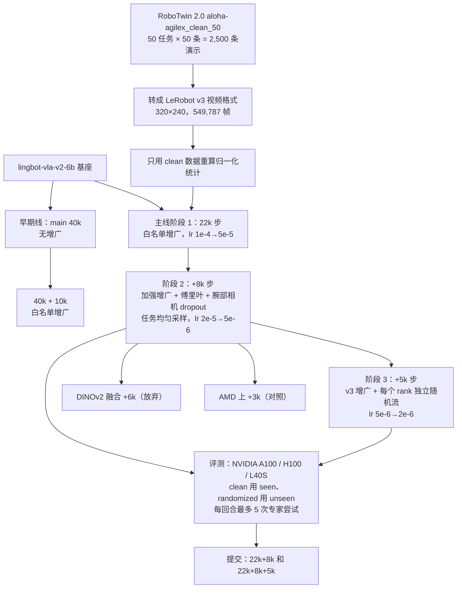
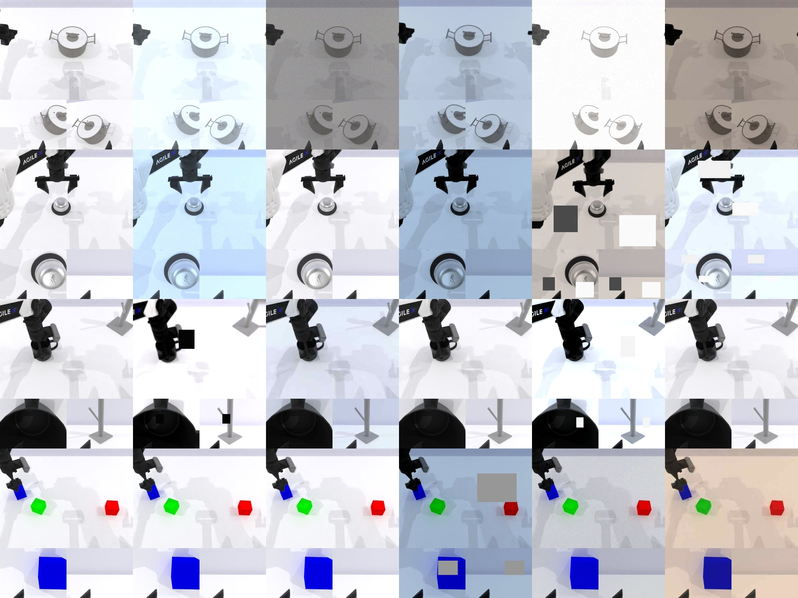
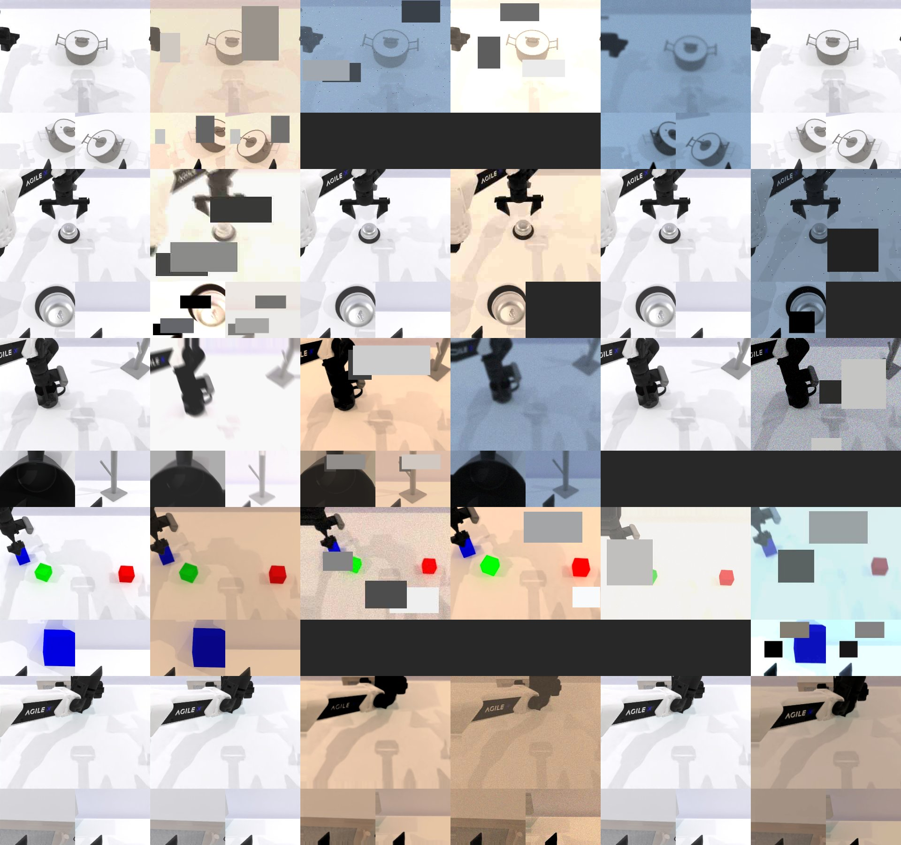

# 初赛：LingBot-VLA 2.0 × RoboTwin 2.0（只用 clean 数据训练）

第一届蚂蚁灵波具身大模型挑战赛初赛的完整记录：我们怎么训、怎么评、得到了什么数字、哪些尝试没有用。
代码在 [`prelim/`](../../prelim/README.md)。

深入阅读：

- [hpc.md](hpc.md)：在我的算力（可抢占的 Slurm 分区）上训练和评测（handoff 组、按时间存档、续训一致性、几个续训 bug）
- [dino.md](dino.md)：DINOv2 视觉特征融合实验，以及它为什么没有赢
- [amd_eval.md](amd_eval.md)：把评测和续训搬到 AMD（ROCm）机器上踩过的坑

目录：[1 赛题](#1-赛题) · [2 方案总览](#2-方案总览) · [3 训练路线](#3-训练路线) · [4 数据增强](#4-数据增强) ·
[5 评测协议](#5-评测协议) · [6 结果](#6-结果) · [7 最终提交和官方成绩](#7-最终提交和官方成绩) · [8 经验教训](#8-经验教训)

---

## 1. 赛题

只写公开规则，用我们自己的话。

- **模型**：基座固定为 LingBot-VLA 2.0（6B，Apache-2.0，`robbyant/lingbot-vla-v2-6b`）。它以 Qwen3-VL-4B 为视觉语言主干，
  用 flow matching 生成动作，一次输出 50 步的动作块（action chunk）。主干必须从这个基座初始化。
- **仿真**：RoboTwin 2.0，aloha-agilex 双臂机器人（每臂 6 个关节 + 1 个夹爪，状态和动作都是 14 维），
  三路相机：头部 + 左右腕部，图像 320×240。
- **任务**：50 个双臂操作任务，例如 `lift_pot`、`stack_blocks_three`、`open_microwave`、`hanging_mug`、`place_dual_shoes`
  （完整列表见 [`configs/tasks50.json`](../../prelim/configs/tasks50.json)）。
- **训练数据**：只能用每个任务的 `aloha-agilex_clean_50`，即 50 条干净场景下的脚本专家演示，共 2,500 条。
  randomized 数据不能以任何形式参与训练，归一化统计也不行。
- **评测**：每个任务在两种设置下各测 100 回合（episode）：
  - `demo_clean`：和训练数据同分布的干净桌面，用 **seen** 指令（训练集里出现过的指令模板）；
  - `demo_randomized`：RoboTwin 2.0 的域随机化场景（桌面杂物、背景纹理、光照、桌面高度等），用 **unseen** 指令。
- **提交**：一个 checkpoint 同时用于两种设置，不能集成多个模型，也不能按任务切换模型。共 3 次提交机会。
  提交物为 `results.json`（官方模板）、代码、权重和复现说明，截止时间 2026-10-26 24:00（北京时间）。
- **数据增强**：有白名单和黑名单，见[第 4 节](#4-数据增强)。外部公开预训练模块可以用，但要披露（[dino.md](dino.md)）。

## 2. 方案总览

一句话：沿用官方 LingBot-VLA 2.0 的 RoboTwin 配方，只在 clean 数据上重算归一化统计；训练时加入白名单内的图像增广、
seen 指令替换和本体状态噪声；再用越来越小的学习率分段续训。算力受限，官方配方是 32 卡、全局 batch 1024、5 万步，
我们用 4 卡、全局 batch 128。

最终提交的是 22k+8k。官方复测：clean 82.22、randomized 57.26、平均 69.74，在公布的 15 支队伍复测表里排第 6（详见[第 7 节](#7-最终提交和官方成绩)）。

两个候选在每个任务前 10 回合上的自测成绩（NVIDIA 评测，50 个任务）：

| 模型 | clean | randomized | 平均 |
|---|---|---|---|
| 22k+8k | 421/500 = 84.2% | 327/500 = 65.4% | 74.8% |
| 22k+8k+5k | 407/500 = 81.4% | 335/500 = 67.0% | 74.2% |

回合数更多时成绩会下降（见[第 5、6 节](#5-评测协议)），按种子配对比较时两者没有差别。

## 3. 训练路线

### 3.1 所有训练线共用的部分

| 项 | 做法 | 为什么 |
|---|---|---|
| 数据转换 | [`src/convert_robotwin_to_lerobot.py`](../../prelim/src/convert_robotwin_to_lerobot.py)：和官方 pi0 流程一致，state = 第 j 帧关节，action = 第 j+1 帧，丢掉最后一帧；每条轨迹随机取一条 seen 指令；fps 50 | 和官方处理保持一致 |
| 图像 | 保持原始 320×240，不放大到 640×480 | 评测客户端发给模型的就是原始分辨率 |
| 存储格式 | LeRobot v3.0 视频格式，而不是把 PNG 嵌在 parquet 里 | LingBot 的数据加载器按行读动作块，嵌图片时每个样本要解码约 150 张 PNG，实测 3.5 s/样本；改成视频后 0.03 s/样本 |
| 归一化统计 | 用官方 `scripts/compute_norm_stats.py` 只在 clean 数据上重算（[`configs/norm_stats/robotwin_clean.json`](../../prelim/configs/norm_stats/robotwin_clean.json)，SHA-256 `92b37257…6bed31`），评测前校验哈希 | 官方的 `assets/norm_stats/robotwin.json` 是 clean + randomized 一起算的，不能用。两者部分关节的 1%/99% 分位数相差 0.2–0.29 rad；把同一个模型（40k+10k）换成官方统计，成功率从 clean 约 77% / randomized 约 40% 掉到 9% / 13.6% |
| 优化器与精度 | 官方配方：Muon（2D 参数）+ AdamW（1D、embedding），FP32 主权重，`torch.compile`；MoE 专家学习率按上游 `use_moe_expert_lr` 放大 √(32/4) ≈ 2.83 倍 | 不改官方配方 |
| 辅助损失 | 官方配方自带的冻结教师：深度对齐（LingBot-Depth + MoGe-2）和视频特征对齐（DINO-Video），权重都是 0.004；教师只看 clean 演示图像，推理时不加载 | 规则 2.5 要求披露，我们在复现说明里写了 |
| 批量 | 全局 batch 固定 128；B200（180 GB）每卡 32，80 GB 卡每卡 16 + 2 步梯度累积；2 卡或小显存卡每卡 8 或 4，加梯度检查点和全分片 | 换卡型续训时学习率日程和数据加载器状态才能接上（[hpc.md](hpc.md)） |

一个 epoch 是 549,787 / 128 ≈ 4,295 步。4×B200 上约 1.55–1.9 s/步（冒烟测试 1.55，阶段 1 为 1.88，阶段 2 为 1.9）。一个完整 checkpoint 约 73 GB，其中可直接推理的 `hf_ckpt` 24 GB。

### 3.2 各条训练线

| 线 | run 名 | 起点 | 步数 | 学习率（余弦） | 增广与采样 | 硬件 / 速度 | 结局 |
|---|---|---|---|---|---|---|---|
| main 40k | `main_b200x4` | 基座 | 40,000（约 9.3 epoch） | 1e-4 → 5e-5，无 warmup | 无增广（上游默认 `image_augment: false`） | 4×B200，约 17.3 小时 | 基线；randomized 很弱 |
| 40k+10k | `strong_main40k_10k` | main 40k | 10,000 | 5e-5 → 2e-5，5% warmup | 白名单增广 `aug_whitelist.json`；seen 指令替换；状态噪声 0.01；视觉塔 lr ×0.1 | 4×B200 | randomized 明显变好，但被主线超过 |
| 主线阶段 1 | `strong_scratch24k` | 基座 | 日程 24,000，取第 22,000 步 | 1e-4 → 5e-5，无 warmup | 同上 | 4×B200，1.88 s/步，约 11.7 小时；被抢占后从第 6k、9k 步续训，第 22,487 步再次被抢占后停止 | 阶段 2 的起点 |
| 主线阶段 2 | `strong_scratch22k_cont8k` | 阶段 1 第 22k 步 | 8,000 | 2e-5 → 5e-6，3% warmup | 加强增广 `aug_strong.json`（含傅里叶幅度调制、腕部相机 dropout）；任务均匀采样 + 静止帧降权 | 4×B200，每卡 16 × 累积 2，1.9 s/步，约 4.3 小时，一次跑完 | **提交（22k+8k）** |
| 主线阶段 3 | `s22k8k_v3uni_15k` → `v3uni_noon` | 阶段 2 第 8k 步 | 日程 15,000，取第 5,000 步 | 5e-6 → 2e-6，前 75% 步内衰减完，3% warmup | `aug_strong_v3.json`（再加随机卷积、更强的颜色和傅里叶）；任务均匀采样 + 静止帧降权；训练器补丁（每个 rank 独立随机流等） | 1–4,500 步：2×A100 后换 2×H100（约 9 s/步）；4,501–5,000 步：2×B200 分支接手 | **提交（22k+8k+5k）**；事后配对比较没有超过 22k+8k |
| DINOv2 融合 | `dino_cont8k_6k` | 阶段 2 第 8k 步 + 零初始化融合层 | 评测第 6,000 步 | 见 [dino.md](dino.md) | 见 dino.md | B200 / H100 / A100 接力 | 放弃：randomized 输给 22k+8k |
| AMD 续训 | `cont8k_v3_nodepth3k_amd` | 阶段 2 第 8k 步 | 3,000 | 5e-6 → 2e-6 | `aug_strong_v3.json`，温度采样 temp:2；深度损失权重降到 1e-8 | 8×AMD W7900D | 只作对照，见 [amd_eval.md](amd_eval.md) |

各阶段实际生效的完整配置（训练程序自动写出的 `lingbotvla_cli.yaml`）在
[`prelim/configs/`](../../prelim/configs/)：`main40k_*`、`stage1_*`、`stage2_*`、`stage3_*`、`dino_cont8k_6k_*`。

### 3.3 为什么这样走

1. **先跑通官方配方（main 40k）**。10 月 20 日开训，4×B200 跑了约 17 小时。上游默认不开图像增广，
   结果 clean 不错，randomized 很差：前 10 个任务各 20 回合，clean 70.0%、randomized 20.5%（旧评测口径，见第 5 节）。
2. **randomized 差，是因为训练只见过干净桌面**。规则允许白名单内的像素级增广，所以 10 月 21 日同时开了两条增广线：
   在 40k 上接着训 10k（快），以及带增广从基座重训（慢，但增广从第一步就在）。
   40k+10k 在同样 10 个任务 × 20 回合上到了 clean 77.0%、randomized 40.0%，说明增广方向对。
3. **重训线成为主线**。它的第 22k 步在 48–49 个任务 × 10 回合上 clean 85.6%、randomized 59.8%（旧口径）。
   两次评测的任务集合不同，不能严格比较，但差距很大，之后的工作都在这条线上做。
4. **22k 而不是 24k**。阶段 1 按 24k 步排的学习率日程，第 22,487 步时被抢占，B200 再排上要等几个小时。
   截止日期很近，于是把计划的 24k+6k 改成 22k+8k，直接从已存的第 22k 步开始阶段 2。
5. **阶段 2：更小的学习率、更强的增广、任务均匀采样**。学习率取阶段 1 的 1/5 到 1/20；增广加大幅度并加入傅里叶幅度调制
   和腕部相机 dropout，针对 randomized；上游按帧数比例采样任务，长任务占得多，我们改成每个任务 1/50，并把几乎静止的帧
   （平均占 21.6%，按任务在 13%–62% 之间）降权到 0.3。相同种子配对比较：randomized 469 个回合里成功数从 284 升到 317
   （阶段 2 赢 60 个、输 27 个，配对检验 p < 0.01），clean 457 个回合里 392 → 395，基本不变。
6. **阶段 3：更小的学习率再训一段**。截止前还有约一天，于是从 22k+8k 再训，用 v3 增广和修好随机流的训练器，
   截止当天中午取当时最新的第 5,000 步作为第二个候选。事后 50 回合配对比较，它和 22k+8k 没有差别（第 6 节）。

## 4. 数据增强

实现在 [`src/lingbot_aug.py`](../../prelim/src/lingbot_aug.py)，通过 [`src/patch_upstream.py`](../../prelim/src/patch_upstream.py)
接进上游的 `transform.py`（由环境变量 `LINGBOT_AUG_CONFIG` 开关，不设置时与原版行为一致）。原则：

- 只在训练时增广，推理时不做任何增广。
- 每个训练样本抽一组参数，三路相机和“未来帧”共用这一组。上游的视频、深度对齐损失要求当前帧和未来帧一致。
- 傅里叶幅度调制只作用于模型输入，冻结教师看到的是调制之前的图。
- 每个样本有一定概率完全不增广（阶段 1、2 为 30%，v3 为 10%），保证 clean 设置的保真度。

### 4.1 白名单内的像素级增广（规则 2.1.1）

| 操作 | 阶段 1 `aug_whitelist.json` | 阶段 2 `aug_strong.json` | 阶段 3 `aug_strong_v3.json` |
|---|---|---|---|
| 不增广的样本 | 30% | 30% | 10% |
| 亮度 / 对比度 / 饱和度 | 0.6–1.2 / 0.7–1.3 / 0.5–1.5 | 0.6–1.2 / 0.65–1.35 / 0.4–1.6 | 0.5–1.25 / 0.6–1.4 / 0.4–1.6 |
| 色温（R 增益 1+t、B 增益 1−t） | ±0.15 | ±0.2 | ±0.25 |
| 小范围缩放平移 | 50%：缩放 0.92–1.08，平移 ≤ 6% | 60%：0.9–1.1，≤ 8% | 60%：0.87–1.13，水平 ≤ 8%、竖直 ≤ 11% |
| 模糊（高斯 / 轻微运动模糊） | 30%：σ 0.3–1.5，运动核 3–7 | 40%：σ 0.3–2.0，运动核 3–9 | 同阶段 2 |
| 高斯噪声 / 椒盐噪声 | 30%（σ ≤ 0.05）/ 10% | 40%（σ ≤ 0.06）/ 15% | 同阶段 2 |
| 随机遮挡（Cutout） | 50%：1–2 块，面积 2–12% | 60%：1–2 块，2–12% | 同阶段 2 |
| JPEG 压缩 | 30%：质量 30–90 | 40%：质量 20–90 | 同阶段 2 |

*阶段 1 参数下的增广效果：每行是一个任务的同一帧，第 1 列为原图，后 5 列是 5 次随机增广；每格上方为头部相机，下方为左右腕部相机。*

调参时靠效果图把关，两处改动都来自看图：第一版亮度上限 > 1.2，近乎全白的 clean 场景被洗成一片白
（[弃用版效果图](img/aug_v0_too_bright.jpg)），收回到 1.2；阶段 2 试过遮挡 1–3 块、面积最大 15%，效果图里会把目标物体整个挡住，收回到 1–2 块、12%。

### 4.2 白名单之外、按规则允许的训练策略

| 改动 | 做法 | 规则依据 |
|---|---|---|
| seen 指令池内替换 | 每次读样本时，把指令换成同一条轨迹自己的 seen 指令列表里的另一条；unseen 指令从不读取（[`src/make_seen_pool.py`](../../prelim/src/make_seen_pool.py)） | 2.1 |
| 本体状态噪声 | 归一化后的 14 维状态加 σ = 0.01 的高斯噪声 | 2.1 |
| 按数据统计量重加权（阶段 2 起） | 任务均匀采样；任务内 `‖action − state‖ < 1e-3` 的静止帧权重 0.3，其余 1（[`src/make_frame_weights.py`](../../prelim/src/make_frame_weights.py)）。权重只由 clean 演示本身算出 | 2.1 |
| 腕部相机 dropout（阶段 2 起） | 每个样本 40% 概率屏蔽腕部视角（一半情况两个都屏蔽，一半随机屏蔽一个），按上游处理缺失相机的方式填充、mask 置 False；头部相机从不屏蔽；推理时不屏蔽 | 2.3 模态 dropout，不合成像素 |
| 视觉塔学习率 ×0.1 | 训练超参 | 2.3 |
| 傅里叶幅度调制（阶段 2 起） | 整幅图做 FFT，幅度谱乘一个平滑的随机正增益（8×8 网格双线性插值，幅度 0.45–1.55），相位和直流分量不变，再变回图像。数学上等于一个随机的零相位线性滤波，是模糊 / 锐化的推广。每个相机实际触发概率约 45%（阶段 2）。不使用任何其他图像的频谱 | 2.1.3 的判据：相当于同一场景换一台成像处理不同的相机拍摄，不产生场景里没有的内容。**主办方答疑确认允许** |
| 随机卷积（只在阶段 3 和之后的实验线） | 一个随机 3×3 或 5×5 卷积核作用于整幅图，RGB 三个通道用同一个核（不混通道），直流增益为 1，所以平坦区域颜色不变、只扰动局部纹理和边缘，指令里的颜色词（“蓝色垫子”）仍然成立；输出按原图均值方差重新标准化后与原图随机混合 | 我们按 2.1.3 同一判据自行判断（与模糊同属线性滤波）；记录中没有主办方对这一项的单独确认 |

*阶段 2 参数：可以看到傅里叶调制带来的整体锐度、色调变化，以及腕部相机被屏蔽时的深灰色块。*

### 4.3 为什么不做黑名单里的

黑名单包括：换背景或桌面纹理、复制粘贴 / 插入物体、重新打光、改变相机内外参或视角，以及有风险的“傅里叶风格迁移”
（把别的图像的幅度谱换过来）。这些恰好是 randomized 设置随机化的因素。用它们从 clean 数据合成出来的样本，
本质上就是自己造 randomized 数据，规则明确禁止。所以我们的增广全部是“同一个干净场景的成像退化”：颜色、噪声、模糊、
小幅几何、遮挡、压缩。傅里叶那一项特意做成只用本图、乘性、保相位，和风格迁移区分开，并事先问过主办方。

v3 把竖直平移上限放到 11%，动机是让模型对桌面高度变化引起的画面上下移动不那么敏感，但它仍然是白名单内的整图平移，
不改场景本身。

## 5. 评测协议

评测流程：每个任务启动一个 LingBot 推理服务（FP32，`--use_length 50`，`torch.compile`）和一个 RoboTwin 评测客户端
（`--seed 0`，种子从 100000 起依次使用，场景完全由种子决定）。官方客户端在每回合开始前先让脚本专家在这个种子的场景上
跑一遍，专家失败就换下一个种子。我们的改动都在客户端副本上（[`src/patch_eval_client.py`](../../prelim/src/patch_eval_client.py)），
RoboTwin 仓库本身不改。

### 5.1 两条规则，以及它们对数字的影响

| 规则 | 官方客户端的行为 | 我们的做法 | 影响 |
|---|---|---|---|
| 指令类型（规则 A.5） | 启动配置里两种设置都写的是 unseen | clean 用 seen，randomized 用 unseen，通过 `--instruction_type` 显式传入 | 只影响 clean |
| 专家尝试上限（主办方答疑第 13 条） | 专家失败就换种子，没有次数上限 | 每回合最多 5 次专家尝试；5 次都失败时，仍在最后一个场景上评测模型并计入次数；场景搭不起来（如 `UnStableError`）记为失败 | 只会让成绩更保守 |

旧口径（无上限、clean 用 unseen）的数字偏乐观：22k 那次 10 回合评测，clean 为了凑满 480 个回合跳过了 283 个专家失败的种子，
randomized 为凑满 490 个回合跳过了 456 个。新口径下 22k+8k 的 20 回合评测里，有 20 个 clean 回合和 42 个 randomized 回合
专家 5 次都失败：其中场景根本跑不起来、直接记失败的分别是 3 个和 10 个；照样评测模型的，模型只成功了 6/17 和 4/32，远低于整体成功率。
所以加上限后成绩会略降。本文第 6 节标了每个数字用的口径。

### 5.2 怎么比较两个模型

- **按种子配对，不按回合编号**。专家能否完成某个种子在两次运行之间并不总是一致（GPU、规划器的数值差异），一旦某个种子
  这次过、那次不过，后面整条种子序列就错开了。例如阶段 3 的 5k 模型和 22k+8k 比，50 个任务里 randomized 有 36 个、clean 有 34 个
  任务的序列错开，同一回合编号上种子相同的只有约 55%。所以我们按（设置、任务、种子）配对，只在两边结果不同的回合上做精确符号检验
  （[`src/compare_paired.py`](../../prelim/src/compare_paired.py)）。
- **前 N 回合不是随机样本**。种子序列是固定的，前几十个种子恰好偏容易还是偏难，会系统地抬高或拉低小样本的成绩。
  22k+8k 在 randomized 上：前 7 回合 65.1%，第 8–10 回合 66.0%，第 11–20 回合只有 53.6%，前 50 回合 58.9%。
  所以 7 回合、10 回合的数字只适合比较同一批种子上的两个模型，不能当成 100 回合成绩的估计。

### 5.3 让评测在抢占队列上跑完

- **断点续跑**：客户端每跑完一回合就把下一个种子、成功数、回合数写进状态文件，被抢占后从下一个种子继续。
  场景只由种子决定，续跑测到的种子与不中断时完全相同。
- **worker 池**：不再每个任务一个数组作业，而是一个作业占着 GPU、不停从共享列表里领（设置，任务）。领取用原子 `mkdir`，
  领取者已不在运行时由别人接手。一张 80 GB 卡同时跑 2–3 个任务；后来改成同一张卡上的多个客户端共用一个推理服务
  （约 25 GB + 每个客户端 6 GB 仿真）：单任务时 GPU 平均利用率只有 15–25%，3 个客户端共用一个服务时约 54%。集群会取消长时间利用率过低的 GPU 作业，这一步也是为了不被它取消。
- **看门狗**：偶尔有回合卡死在仿真器里（主线程空转、GPU 空闲）。评测日志 10 分钟没有新输出就杀掉客户端、从状态文件重试；
  同一回合卡死两次记为失败。
- **重复领取的事故**：曾有 7 个任务被两个 worker 同时跑，日志交错写在一起。我们按日志里的断点记录和每回合的累计成功数
  还原出正式计入的序列（[`src/episode_table.py`](../../prelim/src/episode_table.py)），并修了领取逻辑（接手后 2 秒复查）。
- **硬件**：评测只在 A100 / H100 / H200 / L40S 上跑，RTX PRO 6000 Blackwell（sm_120）上 CuRobo 的扩展没有对应架构，客户端直接起不来。
  一个任务（推理服务 + 客户端）约占 31 GB 显存；一个失败回合约 3.5 分钟。抢占分区上 11–15 个 worker 大约每小时 1,200 个回合。

## 6. 结果

所有数字都来自我们自己在我的算力上的评测（NVIDIA GPU，RoboTwin `13c3c47` + CuRobo，FP32，执行长度 50，clean-only 归一化统计）。
“n × 任务数”表示每个任务测了多少回合、覆盖多少任务。

### 6.1 主要候选（新口径：clean 用 seen、专家最多 5 次）

| 模型 | 回合 × 任务 | clean | randomized | 来源 |
|---|---|---|---|---|
| 22k+8k | 7 × 50 | 296/350 = 84.6% | 228/350 = 65.1% | [`results/s22k8k_7ep_per_task.csv`](../../prelim/results/s22k8k_7ep_per_task.csv) |
| 22k+8k | 10 × 50 | 421/500 = 84.2% | 327/500 = 65.4% | 提交的 [`results.json`](../../prelim/results/submitted_22k8k_first10.json) |
| 22k+8k | 20 × 50 | 833/1000 = 83.3% | 595/1000 = 59.5% | [`results/s22k8k_20ep_per_task.csv`](../../prelim/results/s22k8k_20ep_per_task.csv) |
| 22k+8k | 60 × 50（clean）/ 50 × 50（randomized） | 2486/3000 = 82.9% | 1472/2500 = 58.9% | 同一次评测接着跑 |
| 22k+8k+5k | 10 × 50 | 407/500 = 81.4% | 335/500 = 67.0% | 备选包（未提交）的 [`results.json`](../../prelim/results/candidate_v3uni5k_first10_unsubmitted.json) |
| DINOv2 融合第 6k 步 | 7 × 44（clean） | 257/308 = 83.4% | 见下方配对 | [dino.md](dino.md) |
| AMD 续训 +3k | 7 × 50（randomized）/ 7 × 34（clean，记录时未跑完） | 194/238 = 81.5% | 215/350 = 61.4% | 在我的算力上评测，见 [amd_eval.md](amd_eval.md) |

### 6.2 按种子配对的比较（都以 22k+8k 为对照）

| 比较 | 设置 | 配对回合数 | 候选成功 | 22k+8k 成功 | 结论 |
|---|---|---|---|---|---|
| 22k → 22k+8k（阶段 2 的效果） | randomized | 469 | 317（22k+8k） | 284（22k） | 阶段 2 赢 60、输 27，p < 0.01 |
| 22k → 22k+8k | clean | 457 | 395（22k+8k） | 392（22k） | 持平（注意 22k 那次 clean 用的是 unseen 指令） |
| 22k+8k+5k（每任务 50 回合） | randomized | 2352 | 1420 | 1410 | p = 0.64，无差别 |
| 22k+8k+5k（每任务 50 回合） | clean | 2351 | 1948 | 1960 | p = 0.44，无差别 |
| 22k+8k+6k（每任务 20 回合） | randomized | 925 | 558 | 563 | p = 0.72 |
| 22k+8k+6k（每任务 20 回合） | clean | 941 | 774 | 788 | p = 0.16 |
| DINOv2 融合第 6k 步（21 个任务） | randomized | 139 | 80 | 90 | 只有一方成功的回合 4 对 14，McNemar p = 0.03，DINO 更差 |
| DINOv2 融合第 6k 步 | clean | 290 | 242 | 243 | 持平 |

5k / 6k 的比较是提交之后补测的（截止前只来得及测 10 回合）。5k 在 20 回合时 clean 一度落后 22k+8k（p = 0.022），
测到 50 回合后差距消失。

### 6.3 早期线（旧口径：clean 用 unseen、专家无上限，偏乐观）

| 模型 | 回合 × 任务 | clean | randomized |
|---|---|---|---|
| main 40k | 20 × 10（前 10 个任务） | 70.0% | 20.5% |
| 40k+10k | 20 × 10（同上） | 77.0% | 40.0% |
| 22k（主线阶段 1） | 10 × 48 / 10 × 49 | 411/480 = 85.6% | 293/490 = 59.8% |

22k 的逐任务、逐回合数据在 [`results/s22k_10ep_oldprotocol_*`](../../prelim/results/)。

### 6.4 薄弱任务（22k+8k，每任务 20 回合）

| 设置 | 门槛 | 任务 |
|---|---|---|
| randomized | ≤ 30% | move_can_pot 2/20、open_microwave 3/20、place_mouse_pad 3/20、lift_pot 4/20、put_object_cabinet 4/20、place_can_basket 4/20、move_stapler_pad 5/20、pick_diverse_bottles 5/20、handover_block 6/20 |
| clean | ≤ 55% | move_stapler_pad 5/20、put_object_cabinet 7/20、pick_diverse_bottles 8/20、place_mouse_pad 9/20、handover_block 11/20、stamp_seal 11/20 |

有几个任务 clean 很高、randomized 很低：open_microwave 18/20 对 3/20，move_can_pot 14/20 对 2/20，place_can_basket 17/20 对 4/20。
这类任务的瓶颈是对场景变化的泛化，而不是动作本身。

## 7. 最终提交和官方成绩

最终提交的是 **22k+8k**（`strong_scratch22k_cont8k / global_step_8000`，两段共 30,000 步），代码在 [`prelim/submission/`](../../prelim/submission/README.md)，复现说明见 [reproduction_report_22k8k.md](../../prelim/submission/reproduction_report_22k8k.md)。

| | clean | randomized | 平均 |
|---|---|---|---|
| 我们提交的自测（每任务每个 setting 10 回合，共 500 + 500 回合） | 84.2 | 65.4 | 74.8 |
| **官方复测** | **82.22** | **57.26** | **69.74** |
| 复测 − 自测 | −1.98 | −8.14 | −5.06 |

官方公布的复测表里共 15 支队伍，我们的复测平均分排第 6。

几点说明：

- 自测和复测差了 5 分，主要在 randomized 上，原因是我们只交了每任务 10 回合的自测结果。表里其他队伍大多交了每任务 100 回合（共 5000 回合），差距大多在 2 分以内。我们自己当时其实已经测到 clean 60 回合、randomized 50 回合，结果是 82.9% / 58.9%，和官方复测（82.22 / 57.26）非常接近；前 10 回合的 randomized 成绩恰好偏高。教训：**提交的自测要用自己测得最多的那一份**，回合数少的数字波动大。
- 另准备过一份 22k+8k+5k 的备选包（[`prelim/submission_v3uni5k/`](../../prelim/submission_v3uni5k/README.md)，前 10 回合 clean 81.4%、randomized 67.0%），按第 6.2 节测到 50 回合后和 22k+8k 没有显著差别，最终没有提交。
- 10 月 21 日还做过一份 main 40k 的中间提交包（评测未完成，旧口径），之后被取代。

## 8. 经验教训

1. **先把评测口径对齐规则，再看数字**。我们前几天的数字用的是旧口径（clean 用 unseen 指令、专家失败无限换种子），
   规则澄清后整套重测。如果一开始就逐条核对评测脚本和规则，能省下不少 GPU 时间。
2. **小样本、固定种子序列的成绩会骗人**。22k+8k 的 randomized 从 7 回合的 65.1% 一路降到 50 回合的 58.9%。
   比较模型时一定按种子配对、做配对检验；报告时写清回合数。
3. **归一化统计不是小事**。用错统计（clean + randomized 的官方文件），同一个模型的成功率从 77% / 40% 掉到 9% / 13.6%。
   我们在评测入口校验统计文件的 SHA-256，用错就拒绝评测。
4. **白名单增广对 randomized 最有效**。40k → 40k+10k，randomized 从 20.5% 到 40.0%；22k → 22k+8k，randomized 配对多成功 33 个回合
   （p < 0.01），clean 基本不动。
5. **后期收益递减**。22k+8k 之后用更小的学习率再训 5k、6k，加 DINOv2 融合，都没有超过 22k+8k。
   时间更多的话，我们会把精力花在薄弱任务的分析上，而不是继续堆步数。
6. **为抢占设计，但每一层容错都要单独测**。按时间存档、跨卡型 handoff、续训一致性这些机制让训练在 30 分钟就被抢占的分区上
   跑完了，但它们也引入了几个隐蔽的 bug：续训时数据重放、各 rank 拿到完全相同的样本、续训沿用旧学习率、换卡数续训时挂死。
   DINOv2 实验的结论因此被污染（[dino.md](dino.md)、[hpc.md](hpc.md)）。教训是：续训路径要像主路径一样写测试，
   比如用真实的 `StatefulDataLoader` 在 CPU 上模拟“存档 → 换 rank 数 → 恢复”。
7. **上游代码的隐含假设要逐个确认**：所有 rank 用同一个随机种子；全局 batch 必须等于 micro × 卡数 × 累积步数，但不会自动推算累积步数；
   恢复学习率调度器时会覆盖命令行给的新学习率。
8. **跨平台评测必须用同一版仿真器**。AMD 镜像里的 RoboTwin 版本、运动规划器、渲染器都和官方不同，同一个模型 clean 成绩差了约
   18 个百分点，几个任务直接归零（[amd_eval.md](amd_eval.md)）。
9. **数据格式决定训练能不能跑起来**。把图片嵌在 parquet 里，加载一个样本要 3.5 秒；改成视频，0.03 秒。
