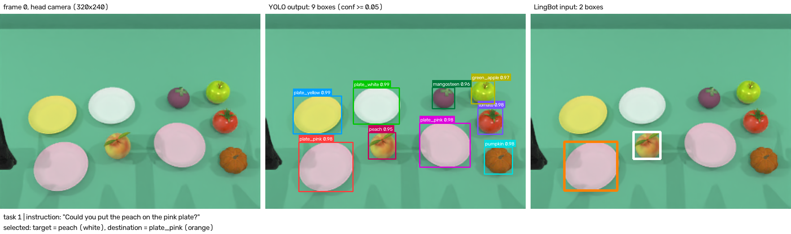
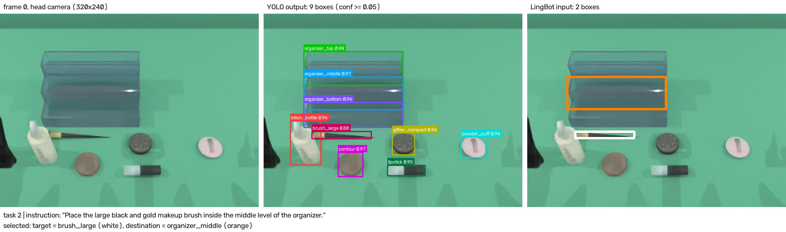
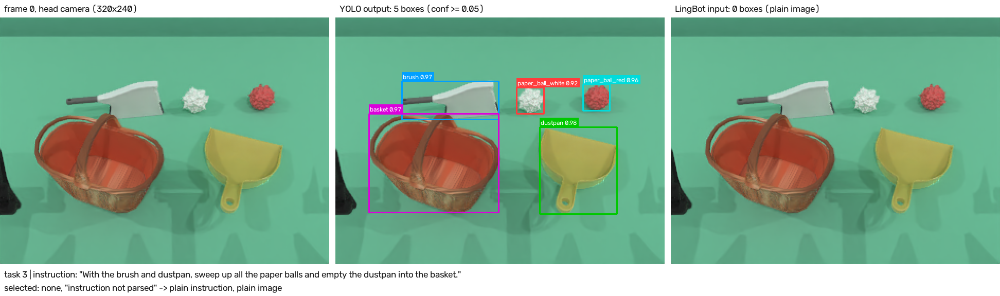
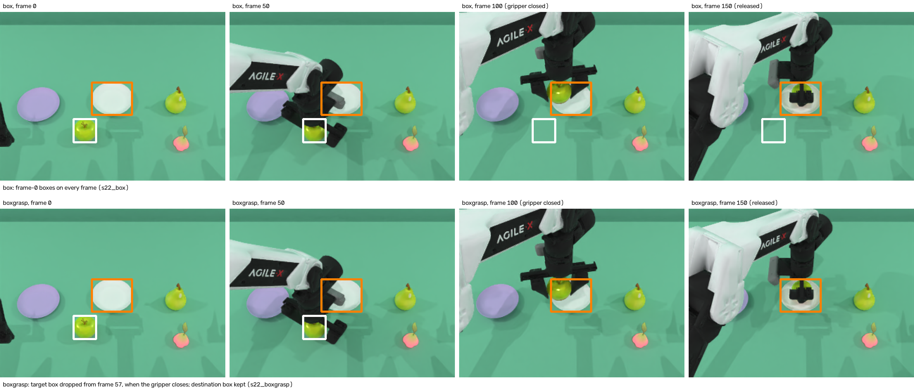

# 决赛物品检测器与画框提示（仿真，11/12–11/14）

> 状态：**仿真部分完成，结论有条件地支持画框；仿真检测器没能迁移到真机。** 画框的做法带去了决赛，检测器权重没有。

## 要回答的问题

决赛任务 1（水果蔬菜放到指定颜色的盘子）的识别分 40 分、任务 2（化妆品放进收纳盒指定层）的识别分 30 分，都只看机械臂**第一次靠近**的是哪个物体。我们想知道两件事：

1. 一个本地小检测器，能不能在决赛的物品和场景里，按评测员的指令选对“目标物”和“目的地”两个框？
2. 把这两个框画在头顶相机画面上交给 LingBot（VLA，视觉-语言-动作模型：输入画面和指令，直接输出机械臂动作），第一次靠近会不会更准？

## 为什么做

赛前方案里，“目标提示”是两条可选增强之一（[赛前技术方案](../../docs/pre_final/plan.md) 第 6 节）：评测员给出指令 → 规则解析出目标和目的地（不用语言模型）→ 头顶相机第 0 帧在 CPU 上跑一次检测器 → 画上白框（目标）和橙框（目的地）→ 交给 LingBot。检测器没把握时不画框，退回纯文本。

队里定的采用门槛：**画框组的首次靠近正确率比纯文本组高 15 个百分点以上，并且画框组不加提示时不变差**，才带去现场。

这个实验替代了 11/11 的 3 色方块代理实验（[yolo_target_prompt](../yolo_target_prompt/README.md)），因为方块代表不了决赛的物品和场景。

## 设置

### 仿真场景

- RoboTwin 2.0 仿真，aloha-agilex 双臂（和 Cobot Magic 同构型），绿布背景和桌布，头顶 D435 相机 320×240，固定灯光。
- 物品按赛题清单：任务 1 的 36 种水果蔬菜和 5 色盘子（每色两个，直径 12 cm）；任务 2 的 10 件化妆品和三层透明阶梯收纳盒（形状和尺寸是我们假设的）；任务 3 的扫把、簸箕、红白纸团、圆筐（只用来训检测器）。56 件资产里 21 件来自 Objaverse（CC 协议，逐件署名在 `assets_meta/licenses.json`），其余来自 RoboTwin 或程序化生成。
- 摆放规则、尺寸，以及哪些是官方规定、哪些是我们的假设，全部写在 [SCENE.md](SCENE.md)。要点：目标物和目标颜色的盘子在同一侧，让单臂能完成；同一侧另放一个别的颜色的盘子，策略不能靠“拿我这边的盘子”蒙对；1/3 的场景从“长得像”的一组里挑干扰物。

### 检测器

- yolo11s，从公开的 COCO 预训练权重开始，认全 59 类（36 种果蔬、5 色盘子、10 件化妆品、收纳盒 3 层、任务 3 的 5 类），120 epoch，imgsz 640。
- 训练图是场景 0–89 的第 0 帧（1800 张，每个场景 20 张：任务 1 11 张、任务 2 6 张、任务 3 3 张，一半开 RoboTwin 的随机灯光）；验证图是场景 90–109（400 张，布局种子和训练不重叠）。**训练和验证用的是同一批 3D 模型，只换了布局和灯光。**
- “按指令选框”（`code/cues_real.py` 的 `select_boxes`）：正则解析 5 种指令模板；目标类最高分的框要求置信度 ≥ 阈值，并且领先同类第二个框 0.15（每个物体只出现一次，两个高分框说明检测器拿不准）；目的地取该类最高分的框。任何一个缺失就整局不画框。

### 画框对比训练

- 起点：初赛时我们在 RoboTwin 上训好的 LingBot-VLA 2.0 6B 权重（从官方底座从头训 22k 步，再续训 8k 步，下文叫“22k+8k”）。没在这个仿真里训过的官方底座什么都完成不了，两组都会接近 0，比不出差别，所以不用它。22k+8k 和官方 6B 同架构同大小。
- 数据：200 条任务 1 专家示范（脚本专家，按清单轮流取目标物）。任务 2 的专家放不进收纳盒（细的化妆刷夹不住，高的乳液瓶会倒），所以对比只做任务 1。
- 两组，各 2000 步、全局 batch 128、学习率 1e-5 → 5e-6 余弦、视觉编码器 0.1 倍学习率、不做图像增强：
  - **纯文本组**：原始画面和指令；
  - **画框组**：同一批示范，一半原图、一半画框（白框目标、橙框目的地，2 像素宽，第 0 帧的框整局不动）。一个模型同时会两种用法。
- 第三组 `boxgrasp`（夹爪合上后撤掉白框、橙框保留，原因见下方示例图）代码写好了，**没有训**。
- 评测：60 个新布局的任务 1 场景（评测前先确认脚本专家能完成），所有条件用同一批场景、同一组策略噪声种子，逐场景配对比较。推理一律 BF16。
- **首次靠近**的判据：从开局起，第一次有任一夹爪中心同时满足“离某个候选物体的初始位置 < 10 cm、比开局时靠近了 > 4 cm、高度 z < 0.90 m”，就记为靠近了这个物体；整局都没有满足算错。这是我们的代理指标，不是官方裁判的评分。

### 算力
我的算力（Slurm）：渲染、示范、评测用可抢占的单卡（A100 / L40S / H100 / H200），训练用排卡工具包的“训练组”在多种卡之间接力，可抢占卡每 15 分钟存一次续训点。B200 跑不了 RoboTwin 的 Vulkan 渲染。

## 结果

> 1、2 两节的数字来自集群上实验目录里的 `det/detector_result.json`、`det/selection.json` 和 `summary.json`（11/12–11/14 读出）；原始逐回合文件没有放进仓库。

### 1. 检测器和“按指令选框”（仿真验证集）

| 指标 | 结果 |
|---|---|
| 检测（验证集 400 张） | precision 0.996、recall 0.999、mAP50 0.995、mAP50-95 0.977 |
| CPU 推理 | 每帧中位约 31 ms（训练脚本里测）/ 42 ms（选框评估里测） |
| 按指令选框，阈值 0.3 | **331/331 全对**（任务 1 213 张、任务 2 118 张；另有 9 张因物体被画面边缘切到而跳过，比赛规则保证物体完整可见） |
| 指令解析 | 1050 条模板指令全部解析正确 |
| 200 条示范的第 0 帧 | 目标物检出 199/200（框和真值 IoU ≥ 0.5），指令解析 200/200 |

这几乎是满分，但训练和验证共用同一批 3D 模型，这个数字只说明“仿真里这条链路是通的”，不代表真实物体上的表现（见第 3 节）。

### 2. 画框对比（任务 1，60 个场景，22k+8k 起点）

| 训练 | 推理时给什么 | 场景数 | 首次靠近正确 | 成功 |
|---|---|---|---|---|
| 纯文本组 | 不给框 | 60 | 43/60（71.7%） | 30/60（50.0%） |
| 画框组 | 仿真真值框 | 60 | 52/60（86.7%） | 32/60（53.3%） |
| 画框组 | 我们的 YOLO 选的框 | 60 | **53/60（88.3%）** | 33/60（55.0%） |
| 画框组 | 不给框 | 60 | 39/60（65.0%） | 27/60（45.0%） |
| 画框组 | 两个框各随机平移最多 ±10% | 20 | 16/20（80%） | 7/20（35%） |
| 画框组 | 每 10 个场景有 1 个给错目标框 | 20 | 16/20（80%） | 9/20（45%） |

和“纯文本组 + 不给框”在相同场景上逐场景配对的差值（首次靠近，百分点；括号里是 3000 次 bootstrap 的 95% 区间）：

| 条件 | 首次靠近差值 | 成功率差值 |
|---|---|---|
| 画框组 + YOLO 框 | **+16.7**（+3.3 ～ +30.0） | +5.0 |
| 画框组 + 真值框 | +15.0（+1.7 ～ +26.7） | +3.3 |
| 画框组 + 不给框 | −6.7（−18.3 ～ +5.0） | −5.0 |
| 画框组 + 平移框（20 个场景） | +10.0（−10 ～ +30） | −10.0 |
| 画框组 + 部分给错（20 个场景） | +10.0（−15 ～ +30） | 0 |

热推理（第 2 次起每次推理）延迟中位数约 0.20–0.23 s，测在集群的 A100 / L40S / H100 / H200 上，不代表 RTX 5080。

怎么读：

- 门槛的第一条刚好过：YOLO 框 +16.7 个点，区间下限 +3.3，显著大于 0。
- 第二条没有定论：画框组拿不到框时比纯文本组低 6.7 个点，区间包含 0，不显著，但也没证明“不变差”。
- 成功率只多了 3–5 个点：画框主要帮的是“拿哪个”，不是“拿得起、放得准”。
- 局限：仿真里 YOLO 几乎全对；只测了任务 1；起点是初赛模型，不是现场微调的官方 6B；框整局不撤（`boxgrasp` 没跑）。

### 3. 仿真检测器在官方真机数据上的检查（11/14，[real_check/](real_check/README.md)）

拿到官方 647 条真机示范后，用这个只见过仿真图的 yolo11s 直接测每条的第 0 帧（阈值 0.25）。真值用首末帧差分自动得到（每条结束时机械臂回到原位，只有目标物变了位置），任务 1 留下 177 条、任务 2 留下 135 条：

| | 任务 1（177 条） | 任务 2（135 条） |
|---|---|---|
| 目标物被框到（不管叫什么） | 79% | 42% |
| 目标类别的框落在目标物上（LingBot 会拿到正确的框） | **33%** | **8%** |
| 目的地类别的框里装着最后放下的物体 | 40% | 11% |

- 能框到大部分物体，但类别基本认不对：蓝盘全部、紫盘几乎全部被叫成白盘；橙子、柿子、木瓜多被叫成橘子；化妆品除眼影盘（10/23）外基本是 0。
- 任务 3 的篮子 162 次被叫成白盘，刷子 159 次被叫成篮子；黄纸团约 190 个一个都没检出（仿真里只有红、白两色纸团）。
- 阈值降到 0.1 只是多框到一些物体，认对的比例基本不变（任务 1 36%，任务 2 12%）。

## 结论与状态

- **画框（仿真）：完成。** 按我们定的门槛，YOLO 框带来的首次靠近提升刚过线，“拿不到框时不变差”没有定论。
- **16 GB 显存实测：取消。** 原计划把推理服务显存限制在 15 GB、用画框组 + YOLO 框跑 10 回合（`server.py` 的 `LINGBOT_MEM_CAP_GB`），11/13 从流程里去掉，没有跑。同一个 6B 模型在其他实验里的显存记录见 [实验总览](../../docs/pre_final/experiments.md)。
- **`boxgrasp` 组、YOLO-World 零样本对比：没做。** YOLO-World 的词表已经离线编码好（`code/yoloworld_prep.py`），但没跑出“按指令选框”的结果。
- **仿真检测器：不能迁移。** 真机上目标认对只有 33%（任务 1）和 8%（任务 2）。它只见过我们找来近似的 3D 模型和仿真渲染（训练和验证还共用同一批模型，所以仿真里的满分说明不了泛化）；真机相机下紫盘偏灰或偏粉、蓝盘很浅；真机上还有仿真里没有的东西（黄纸团）。

## 在决赛中用上了什么

- **画框的做法整套搬到了真机**：白框目标、橙框目的地；规则解析指令；目标置信度够高且领先同类第二个框 0.15 才画，没把握就给原图；训练数据一半画框、一半原图；夹爪合上后撤掉白框（`boxgrasp` 的思路）。真机上抓取时刻改用夹爪**指令**判断，因为大物体（如南瓜）合上时夹爪读数变化太小。见 [docs/final/inference.md](../../docs/final/inference.md)、[final/inference/yolocue/](../../final/inference/yolocue/README.md)。
- **检测器换成在真机数据上重训的**：仿真权重没有用。第一天改为用开放词汇定位模型 LocateAnything-3B 自动标注官方示范，再训 yolo11s，之后人工核对、逐版迭代，见 [docs/final/yolo.md](../../docs/final/yolo.md)、[final/data/autolabel/](../../final/data/autolabel/)。
- **real_check 的差分真值**（`real_check/diffgt.json`，312 条目标物框）成了之后各版检测器的验收集。
- `code/field_build.py` 等是现场数据看板（“现场作战台”）的早期版本，最初用的就是这个仿真检测器；real_check 之后知道它在真机数据上给出的“没检测到”标记大多是误报。

## 示例图

图在 `figures/`，用 `code/make_figures.py` 生成。画面是头顶相机原始的 320×240，放大 2 倍显示，来自验证集。

**YOLO 输出了什么，LingBot 拿到了什么。** 每张图从左到右：第 0 帧原图；YOLO 的全部输出（置信度 ≥ 0.05，带类名和置信度）；交给 LingBot 的画面。YOLO 框出场景里每个物体，再按指令只留两个框：白框是目标，橙框是目的地，框上不写类名。

任务 1：9 个框里留下桃子和粉盘。场上有两个粉盘，选离桃子近的那个。

任务 2：收纳盒的每一层是单独一类，9 个框里留下大号化妆刷和中层。

任务 3：YOLO 框出了簸箕、扫把、圆筐和两个纸团，但指令不是任务 1、2 的模板，解析不出目标，所以不画框，画面和指令都不变。

**框在整局里怎么变（第 0000 条示范，任务 1）。** 取 LingBot 每次推理时看到的帧：第 0、50、100、150 帧（每次推理执行 50 步）。

- 上面一排是 `box`：第 0 帧的框每一帧都画。苹果被拿起以后，白框框住的是空桌面。
- 下面一排是 `boxgrasp`：第 57 帧夹爪合上以后不再画白框，橙框一直保留。“夹爪合上”只看关节状态：夹爪离起始位置超过行程的一半就算合上，之后不再恢复；训练数据和推理用同一条规则（`cues_real.GraspLatch`）。200 条示范里白框在第 54–84 帧撤掉，训练帧里有 35% 带白框。
- 没有选“第 0 帧之后都不画框”：LingBot 每次推理只看当前一帧、一次执行 50 步，抓取发生在第 50 帧那次推理之后，那时已经看不到框；训练数据里也只会剩 200/34,367 帧带框，模型学不会用框。

## 文件说明

| 文件 | 内容 |
|---|---|
| [SCENE.md](SCENE.md) | 场景怎么布置：三个任务的摆放规则、尺寸、成功判定、指令模板、种子，以及怎么自己摆一个场景 |
| `code/process_assets.py` | 资产处理：Z 轴朝上、居中、按玩具尺寸缩放、可抓宽度 ≤ 6 cm、算抓取点；程序化生成山竹、柿子、化妆品、盘子、纸团 |
| `code/catalog.py` | 59 类名单、英文名、指令模板、易混组（不依赖仿真器） |
| `code/scene_real.py` | 三个任务的 RoboTwin 场景、布局采样、脚本专家、成功判定、分割图取框 |
| `code/show_scene.py` | 按参数摆一个场景，存头顶相机第 0 帧、带框的图和每个物体的坐标 |
| `code/cues_real.py` | 指令规则解析、画框 / 坐标提示、从检测结果里选框、`GraspLatch` |
| `code/det_render.py`、`code/train_yolo_real.py`、`code/select_eval.py` | 检测图渲染、训练 yolo11s、按指令选框评估 |
| `code/yoloworld_prep.py` | YOLO-World 词表离线编码（没跑出结果） |
| `code/collect_real.py`、`code/prepare_data_real.py`、`code/train_real.sh` | 采专家示范、转成 LeRobot 数据（纯文本 / 画框 / boxgrasp 三份）、训练 |
| `code/eval_real.py`、`code/eval_batch.sh`、`code/server.py`、`code/summarize_real.py` | 配对评测（每回合固定噪声种子；`server.py` 的 `LINGBOT_MEM_CAP_GB` 可限显存）、汇总成 `summary.json` |
| `code/setup_pool.sh`、`code/setup_ab.py`、`code/phases_ab.py`、`code/controller_ab.py`、`code/controller_real.sh` | 集群上的 worker 池、训练组、阶段表和登录节点控制器 |
| `code/integ_6b.py`、`code/integ.sh`、`code/integ.sbatch` | 已取消的官方 6B 接口测试（22k+8k 和官方 6B 同架构，YOLO 框评测已经跑通整条链路） |
| `code/smoke_real.py`、`code/debug_expert.py`、`code/*.sbatch`、`code/runtime.sh` | 冒烟测试、调专家、Slurm 脚本、运行环境入口 |
| `code/make_figures.py`、`figures/` | 上面的示例图 |
| `code/field_build.py`、`code/field_sync.sh`、`code/field_watch.sh` | 现场数据看板的早期版本：对每条示范第 0 帧跑检测器、统计覆盖和质量、发布到看板 |
| `assets_meta/assets.json`、`assets_meta/licenses.json` | 每件资产的尺寸、抓取点、来源；Objaverse 模型的链接和 CC 协议 |
| [real_check/](real_check/README.md) | 仿真检测器在官方真机数据上的检查：脚本、差分真值、示例图 |

资产文件、检测器权重、检测训练 / 验证图和 200 条示范（5.8 GB）不在本仓库，放在一个 Hugging Face 数据集里（`<hf-dataset>`，目前未公开）。代码里的路径是集群上的 `$SCRATCH/lingbot/...`，换机器要改 `runtime.sh` 和各脚本开头的路径；`#SBATCH` 行不会展开变量，要手动填。
